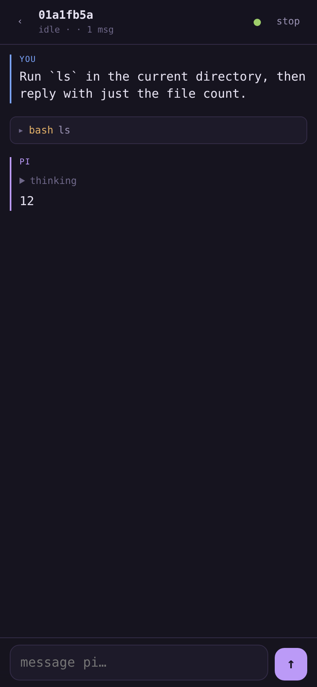

# pixip

`pi` × `ip`: a phone-first web view of Pi sessions. Not a terminal mirror — a
transcript, streamed from real `pi` processes, that reflows, scrolls natively and
has a normal text box instead of a pane grid.

Prototype. Single supervisor process (`pixip`) + static client, no build step.

| phone | desktop |
|---|---|
|  |  |

```bash
npm install
node bin/pixip.ts --data-dir ./tmp/dev        # http://127.0.0.1:8137/
```

`--data-dir` is the isolation boundary: Pi runs with `--session-dir
<data-dir>/sessions`, so pointing it at a scratch directory never touches
`~/.pi/agent/sessions`.

## Why

Existing options are slow, shaped around terminals or editors, and some of them
need plugins rewritten to work:

| | Substrate | What it costs |
|---|---|---|
| AoE | tmux + PTY | web UI mirrors a terminal: fixed columns, copy mode, chords on a phone; agent-agnostic so Pi's structure is lost |
| pi-web | spawns pi over WS | one process, no lifecycle (stop/restart/fork), sessions die with the server |
| pi-acp / ACP | one adapter per session | editor-shaped; a session belongs to one client |

pixip is built on `pi --mode rpc`: a long-lived Pi subprocess with a JSON command
and event stream. That means **no PTY, no tmux, no terminal emulation**, and
**every existing Pi plugin keeps working unchanged** — the supervisor runs the
real `pi` binary, so extensions, skills, prompts and themes load exactly as they
do in the TUI.

## Goals

1. **Fast, in both senses.** Hub overhead in single-digit milliseconds
   (measured: prompt→`agent_start` 6 ms, prompt→user echo 18 ms, stop 46 ms), and
   a UI that stays responsive on a phone: append-only DOM, rAF-batched deltas,
   raw event passthrough (no server-side re-encoding), one websocket, no polling,
   no framework, ~25 KB of JS.
2. **Ergonomic on a phone, and responsive by contract.** Native scroll, soft-wrap
   with no horizontal scroll, 16 px input (no iOS zoom), sticky composer,
   safe-area padding, tap targets, collapsed tool output, approvals as a bottom
   sheet instead of "go find the terminal". One asset set serves every width:
   the phone layout is verifiable by resizing a desktop browser, and a wide
   window is expected to show *more* (session cards or a rail), not a stretched
   single column.
3. **Pi's semantics, not a byte stream.** Messages, thinking, tool calls and
   results, compaction notices, `session_info_changed` — the things a terminal
   hides in scrollback.
4. **Multi-session by construction.** The supervisor owns sessions: list, attach,
   detach, stop, resume. That is impossible from inside a single session's
   plugin, which is why this is a process and not an extension.
5. **Cheap on a small box.** An idle session is detached after `--idle-ms`
   (default 15 min); its JSONL stays and `--session <file>` resumes it on demand.

## What works today

- session list with live state (idle/busy/stopped/error), create from a path,
  open, stop, wake/reattach;
- streamed transcript: user/assistant text, thinking collapsed, tool calls with
  ANSI output, error styling, durations;
- composer: send while idle, steer while streaming, abort via `stop`;
- per-session model and thinking level, picked from the footer (`get_available_models`
  / `set_model`, `get_available_thinking_levels` / `set_thinking_level`);
- the TUI status line: pwd + branch + session name, token totals, cost, context
  usage with the TUI's thresholds, and `model • thinkingLevel`;
- extension dialogs (`select`/`confirm`/`input`/`editor`) rendered as a sheet and
  answered from the phone; `notify` as a toast;
- reconnect with backoff, durable entry-cursor resume and a stable pixip logical
  session id per session, so a dropped phone misses no entries;
- sessions that were never prompted still list after detach (session index);
- test isolation via `--data-dir`.

TUI command parity is the current focus (developing pixip inside pixip); see
[`docs/parity.md`](docs/parity.md) for the command-by-command coverage map and the
tickets that own each gap.

## Not yet

- TUI visual parity: diff/syntax colouring and the TUI's own theme colours (theme
  values are `okhsl`, which browsers do not support without conversion — see
  `85-theme-tokens`);
- the TUI command surface: slash built-ins, the command menu, queue display and
  branch/session commands (tracked in `docs/parity.md`);
- daemon lifecycle and self-refresh (`01-daemon-refresh`);
- worktree creation, image input, input history and `@file` completion;
- virtualised transcript for very long sessions;
- auth of any kind (bind loopback, or a private VPN interface — same posture as
  `aoe serve --host 100.42.42.1 --auth none`).

## Checking the layout

The responsive contract is verified by resizing, not by owning a phone. With any
Chromium/Chrome binary:

```bash
PIXIP_CHROME=/path/to/chrome node tools/shot.mjs http://127.0.0.1:8137/ 390 844 phone.png
PIXIP_CHROME=/path/to/chrome node tools/shot.mjs http://127.0.0.1:8137/ 1280 900 desktop.png
```

It prints the box model of the header/list/log/composer (so a resize is asserted,
not eyeballed), flags horizontal overflow, console errors and page errors, and
writes the screenshot. Use `--dev` on the daemon so CSS/JS edits need no restart.

## Layout

```
bin/pixip.ts        supervisor entry: flags, data dir, signals
src/rpc.ts          `pi --mode rpc` peer: LF framing, id correlation, raw records
src/hub.ts          session registry, spawn/attach/stop, idle policy, disk scan
src/wire.ts         hub <-> browser frames (v1)
src/server.ts       http + ws, static client
src/client/         index.html, style.css, app.js, render.js (pure, unit-tested)
test/               protocol/rpc tests and ANSI/render tests
```

Work is tracked on a strict FIT board in `fit/` (backlog holds the known gaps
from "Not yet"). See [AGENTS.md](AGENTS.md) for the rules that apply to changes.

See [ARCHITECTURE.md](ARCHITECTURE.md) for invariants, the wire protocol, measured
latency, the memory policy, and the Rust-port map.

## Relationship to AoE

Eventually this replaces AoE for Pi sessions. Not yet, and not co-running: two
supervisors over the same repo will disagree about worktrees and session
ownership. AoE keeps working untouched until pixip covers the same ground.
