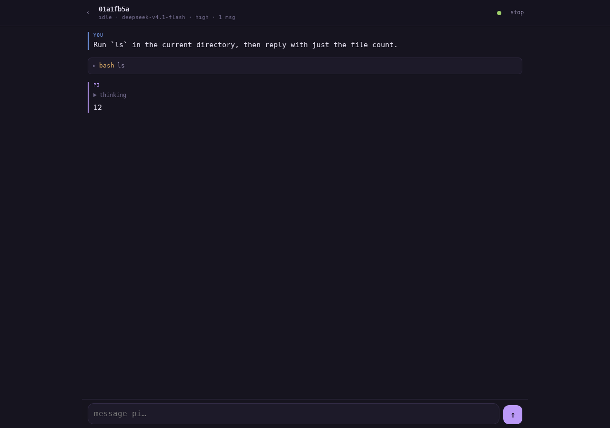

# pixip

`pi` × `ip`: a phone-first web view of Pi sessions. Not a terminal mirror — a
transcript, streamed from real `pi` processes, that reflows, scrolls natively and
has a normal text box instead of a pane grid.

Prototype. Single supervisor process (`pixip`) + static client, no build step.

| phone                            | desktop                              |
| -------------------------------- | ------------------------------------ |
|  |  |

```bash
npm install
node bin/pixip.ts --data-dir ./tmp/dev        # http://127.0.0.1:8137/
```

`--data-dir` is the isolation boundary: Pi runs with `--session-dir
<data-dir>/sessions`, so pointing it at a scratch directory never touches
`~/.pi/agent/sessions`.

`pi-host/` is a workspace package, `pixip-pi-host`: an embedded Pi RPC host
that adds a blocking `panel` UI request for A2UI while otherwise keeping Pi RPC
v1. See [pi-host/README.md](pi-host/README.md). It is the default backend:

```bash
node bin/pixip.ts --data-dir ./tmp/dev                  # spawn pixip-pi-host
PIXIP_PI_HOST=/path/to/pixip-pi-host node bin/pixip.ts  # override the host bin
```

The legacy `pi --mode rpc` backend is an explicit opt-in and needs a Pi
executable from `--pi` or `PIXIP_PI`:

```bash
node bin/pixip.ts --data-dir ./tmp/dev --use-system-pi --pi /path/to/pi
PIXIP_PI=/path/to/pi node bin/pixip.ts --data-dir ./tmp/dev --use-system-pi
```

A missing host executable fails startup with an install hint instead of silently
falling back. The host embeds the project-local Pi SDK and shares the user's Pi
agent dir and extension set for now; plugin/config isolation is tracked in
`90-pi-plugin-isolation` on the board.

### Inline panels and questionnaires

Blocking `panel` requests from the host render in a collapsible surface between
the transcript and the composer, not as a modal. A2UI v1.0 surfaces use a
vendored renderer that is fetched only when the first panel arrives; extension
dialogs stay a bottom sheet. The hub never parses A2UI, and completed surfaces
are not written to session history (a pending panel replays on reattach).
Questions are not cancelled just because the browser is closed: the hub waits
5 hours detached or 10 hours with a browser attached, then records a timed-out
request so the session can offer a re-ask when it is reopened.

`extensions/pixip-questionnaire` registers the `questionnaire` tool with a
widget-shaped schema (`choice` or `text`). Transport order is A2UI inline panel
(when the host has one) → TUI custom UI → sequential dialogs, with the ACP
"Answer this in chat" hand-off on hosts that cannot collect typed text. It is a
local checkout, unpublished:

```bash
pi install /path/to/pixip/extensions/pixip-questionnaire
```

It replaces `pi_questionare` for pixip sessions, but nothing uninstalls the old
package for you. Once the new tool works for you, remove the old one; removal
only affects that user's Pi settings (or the project settings for `-l`):

```bash
pi list
pi remove /path/to/pi_questionare
```

`extensions/pixip-show-image` registers `show_image_to_user`, the agent's
explicit way to show one local image in the transcript. Pixip renders it as a
thumbnail on the tool card; a plain Pi TUI keeps the `file://` link. Install it
the same way:

```bash
pi install /path/to/pixip/extensions/pixip-show-image
```

`extensions/pixip-agents` registers `agent_list`, a read-only way for an agent
to find other sessions (live, attached or stopped) and get their absolute
`#s=<id>` page URL. Archived/trash sessions are opt-in with `all: true`.

```bash
pi install /path/to/pixip/extensions/pixip-agents
```

## Why

Existing options are slow, shaped around terminals or editors, and some of them
need plugins rewritten to work:

|              | Substrate               | What it costs                                                                                                    |
| ------------ | ----------------------- | ---------------------------------------------------------------------------------------------------------------- |
| AoE          | tmux + PTY              | web UI mirrors a terminal: fixed columns, copy mode, chords on a phone; agent-agnostic so Pi's structure is lost |
| pi-web       | spawns pi over WS       | one process, no lifecycle (stop/restart/fork), sessions die with the server                                      |
| pi-acp / ACP | one adapter per session | editor-shaped; a session belongs to one client                                                                   |

pixip is built on `pi --mode rpc`: a long-lived Pi subprocess with a JSON command
and event stream. That means **no PTY, no tmux, no terminal emulation**, and
**every existing Pi plugin keeps working unchanged** — the supervisor runs the
real `pi` binary, so extensions, skills, prompts and themes load exactly as they
do in the TUI.

## Goals

1. **Fast, in both senses.** Hub overhead in single-digit milliseconds
   (measured: prompt→`agent_start` 6 ms, prompt→user echo 18 ms, stop 46 ms), and
   a UI that stays responsive on a phone: append-only DOM, rAF-batched deltas,
   raw event passthrough (no server-side re-encoding), one websocket, no polling,
   no framework, ~25 KB of JS.
2. **Ergonomic on a phone, and responsive by contract.** Native scroll, soft-wrap
   with no horizontal scroll, 16 px input (no iOS zoom), sticky composer,
   safe-area padding, tap targets, collapsed tool output, approvals as a bottom
   sheet instead of "go find the terminal". One asset set serves every width:
   the phone layout is verifiable by resizing a desktop browser, and a wide
   window is expected to show _more_ (session cards or a rail), not a stretched
   single column.
3. **Pi's semantics, not a byte stream.** Messages, thinking, tool calls and
   results, compaction notices, `session_info_changed` — the things a terminal
   hides in scrollback.
4. **Multi-session by construction.** The supervisor owns sessions: list, attach,
   detach, stop, resume. That is impossible from inside a single session's
   plugin, which is why this is a process and not an extension.
5. **Cheap on a small box.** An idle session is detached after `--idle-ms`
   (default 15 min); its JSONL stays and `--session <file>` resumes it on demand.

## What works today

- session list grouped by repository and worktree with collapsible sections
  (collapsed by default), live state (idle/busy/stopped/error), create from a
  typed path, from the home-fenced directory picker (`browse`), from a group's
  `+`, or as `new with worktree`, open, stop, wake/reattach; collapsing keeps
  hot/warm sessions and each group's newest session visible by default,
  configurable from the header gear;
- first-prompt session labels: a separate one-shot Pi call summarizes the
  substantive task in the first prompt to 3-5 words, ignoring slash-command
  boilerplate (a command is labeled from the user message it expands into;
  `--title-model` / `PIXIP_TITLE_MODEL` overrides the current session model;
  local fallback), while a manual rename always wins;
- streamed transcript: user/assistant text, thinking collapsed into one box per
  assistant message with an expandable live stream while the agent is thinking,
  tool calls with ANSI output, error styling, durations;
- composer: send while idle, steer while streaming, abort via `stop`; a `+`
  menu attaches one image (camera/library, downscaled client-side) or one
  arbitrary file (uploaded under `<data-dir>/uploads/` and handed to Pi as a
  path), with an inline removable preview and clipboard paste;
- `!cmd`/`!!cmd` bash cards (streamed output, exit code, `!!` excluded from the
  model context), slash-command passthrough for extension commands/templates/
  skills, and a restrict-only per-session command policy (`pixip.json`,
  `--allow-command`/`--deny-command`/`--no-bash`) — see `docs/TUI-parity.md`;
- the RPC-drivable built-ins from the composer: `/compact`, `/name`, `/session`,
  `/copy`, `/model`, `/thinking`, `/new`, `/resume`, `/quit`;
- per-session model and thinking level, picked from the footer (`get_available_models`
  / `set_model`, `get_available_thinking_levels` / `set_thinking_level`);
- the TUI status line: pwd + branch + session name, token totals, cost, context
  usage with the TUI's thresholds, and `model • thinkingLevel`;
- transcript text size: `A−`/`A+` in the header, seven steps from 50 % to 150 %,
  device-local (`localStorage`), scaling only the transcript so the composer and
  the rest of the chrome stay fixed (long-press resets, `Ctrl/Cmd` `-`/`+`/`0`);
- a dashboard bottom bar with the newest inbox message preview and a live
  unread badge (hidden while the inbox is empty and no agent has the
  `pixip-inbox` extension loaded), opening a dedicated `#inbox` page with
  all/unread/purpose/archived filters, read/archive/restore/delete actions and
  a tap-to-session reply that prefills the composer;
- dashboard settings sheet from the header gear, with a device-local toggle for
  keeping hot/warm and newest sessions visible in collapsed groups, plus
  `archived` and `trash` views (restore or permanently delete);
- session archive/delete from each row's actions menu, with a short delete undo,
  and an `archive inactive` action that keeps the newest session in any group
  that has no active sessions;
- extension dialogs (`select`/`confirm`/`input`/`editor`) rendered as a sheet and
  answered from the phone; `notify` as a toast;
- reconnect with backoff, durable entry-cursor resume and a stable pixip logical
  session id per session, so a dropped phone misses no entries;
- sessions that were never prompted still list after detach (session index);
- daemon lifecycle: `pixip daemon|stop|status|logs|refresh|restart` (`pixip
run` serves in the foreground) with pid,
  state and log under `--data-dir`; soft refresh re-reads assets, command policy
  and the session index without touching live children, and a `reload` action in
  the header does the same from the phone;
- `restart --when-idle` as the safe self-update, with sessions surviving in their
  JSONL;
- test isolation via `--data-dir`.

TUI command parity is the current focus (developing pixip inside pixip); see
[`docs/TUI-parity.md`](docs/TUI-parity.md) for the command-by-command coverage map and the
tickets that own each gap.

## Running as a daemon

Bare `pixip` and `pixip run` serve in the foreground; `pixip daemon` manages a
detached process:

```bash
pixip daemon --data-dir ./tmp/dev         # prints the URL, writes pid/state/log
pixip daemon --watch                      # reload src/ + extensions/ after edits
pixip status [--json]                     # non-zero when not running
pixip logs [-f] [--lines 200]             # tails <data-dir>/pixip.log
pixip refresh                             # soft: assets, policy, session index
pixip reload                              # assets + every live child, in place
pixip restart [--force] [--when-idle]     # replace the process, JSONL survives
pixip protect [<session-id>] [--off]      # exclude a session from bulk archive
pixip stop
```

`--data-dir` owns everything (`pixip.pid`, `pixip.state.json`, `pixip.log`,
`sessions/`, `inbox.json`), so parallel instances on another `--port`/`--data-dir` never
collide. One process owns a data dir at a time: the bare foreground command
refuses to start when a daemon already owns it. Soft refresh (`pixip refresh`,
`SIGHUP`, or the header's `reload`) keeps children and sockets, and its endpoint
accepts loopback peers and the exact bind address because the UI has no auth.
`/reload` (or `pixip reload`) is the in-place step beyond that: it refuses while
any session is busy, re-reads assets/policy/index, reloads every live host child
(auto-respawning system-pi children to the current host), keeps a local
transcript notice, and refreshes every connected page for the new nonce. It is
user-only; a `pixip reload` run from inside an agent exits 2. `--watch` is an
off-by-default developer convenience: a 200 ms debounce over `src/` and
`extensions/` runs the same reload. A busy session defers the reload (the
daemon keeps polling and shows a "reload deferred" card after a minute) rather
than interrupting; a failed reload, including a half-written file, is logged and
shown as a notice while the daemon keeps serving. Hard restart
refuses while a session is busy unless `--force`;
`--when-idle` waits up to `--timeout` seconds (default 300, exit 2) for the other
sessions and is the safe way to pick up hub changes from inside pixip: the
stop/start runs in a detached helper that survives the calling session, and
`pixip stop` issued from inside a session restarts instead of taking the service
down (use a shell outside pixip to really stop it). The phone reconnects with
backoff and its durable cursor, and sessions reattach from their JSONL.

`pixip protect` marks one session as excluded from the dashboard's bulk archive
(the protected row shows a purple dot). With no id it uses the caller's
`PIXIP_SESSION_ID`, so an agent can protect its own session; `--off` clears it,
and the flag is stored in the session index so it survives restarts and
archive/restore. The explicit `archive` action still works on a protected
session.

## Inbox

Agents can leave durable messages for the user without keeping a session open.
The inbox is `<data-dir>/inbox.json`, owned by the hub (atomic temp+rename, no
expiry, default cap 200), so it survives restarts and the deletion of the
sending session; each message keeps a sender snapshot (name, cwd, branch, Pi
id), while its status (running/idle/stopped/archived/deleted) is resolved live.
Deleted ids are kept as a bounded tombstone list, so a copied ref can report
"deleted" instead of "unknown" after the message is gone.

```bash
pixip inbox send --subject "Review the migration" --purpose attention-needed "tests pass"
pixip inbox list [--unread] [--archived] [--json]
pixip inbox read <id|all>
pixip inbox archive <id>
pixip inbox delete <id>
```

Inside a Pi child the sender is the calling session (`PIXIP_SESSION_ID`); a
plain shell is labelled `local shell`. The CLI talks to `PIXIP_DAEMON_URL` when
set, otherwise to the daemon running for `--data-dir`. Purposes are
`attention-needed`, `deliverable`, `extra-info` and `no-rush`.

The REST surface is `POST/GET /api/inbox`, `POST /api/inbox/reports`,
`POST /api/inbox/read-all`, `POST /api/inbox/:id/read|archive|restore`, and
`DELETE /api/inbox/:id`; the dashboard socket receives an `inbox` frame with the
unread count and newest message on every change. `POST /api/inbox/extension` is
the addon's one-shot "I am loaded" report: while it has not been seen and the
inbox is empty, the dashboard bar stays hidden instead of showing dead chrome.
The flag lives in daemon memory, so a restart re-learns it from the next Pi child
that loads the extension. `--inbox-token` (or `PIXIP_INBOX_TOKEN`) turns on the
`Authorization: Bearer` seam for the API and passes the same token to Pi
children; it is off by default. Every child gets `PIXIP_DAEMON_URL` regardless.

### HTML reports

An agent can attach an HTML report to a message. Reports are agent-only (there is
no CLI command) and live in hub-owned directories under `<data-dir>/reports/`.
The `inbox_report` tool is the only editing surface:

```text
inbox_report({action:"new", name:"migration"})
inbox_report({action:"add_asset", name:"migration", path:"/tmp/chart.png"})
inbox_report({action:"write", name:"migration", html:"<!doctype html>…"})
inbox_send({subject:"Migration report", body:"The staging run is green.", purpose:"deliverable", reportName:"migration"})
```

`write` validates the whole document and requires `existingHtml` (the exact
current HTML from `action:"show"`) when overwriting. `add_asset` copies a local
PNG/JPEG/GIF/WebP/SVG/CSS/font into the top level of the report and returns the
filename to reference. Local images are capped at 1 MiB each, `index.html` at
1 MiB and the whole report at 10 MiB. No JavaScript, iframes, objects/embeds,
event handlers, external resource loads or form submission; form markup is
allowed for style demos, and external `<a href>` navigation is allowed. Use
`add_asset` for remote images rather than linking them.

The report is served at `/reports/<name>/` (relative assets work, and
`/reports/<name>` redirects to the slash) with a locked-down CSP. There is no
report auth: the trust boundary is the same as the dashboard. A report can be
attached to more than one message; deleting or evicting the last message that
references it removes the directory. Unattached drafts older than 24 hours are
swept.

`extensions/pixip-inbox` is the opt-in agent face: `inbox_send({subject, body,
purpose, reportName?})` and `inbox_report({action, …})` post to the same
endpoint, send `PIXIP_INBOX_TOKEN` only when it is set, and return a tool error
(daemon down, wrong token, validation failure) instead of crashing. Calling
`inbox_report` with no arguments prints its help text. On load the extension
announces itself (best-effort, failures ignored), which is what makes the empty
inbox bar appear.

```bash
pi install /path/to/pixip/extensions/pixip-inbox
```

## Agent discovery

An agent can find other pixip sessions without opening the web UI. The surface
is read-only and shared by the CLI, the dashboard-independent API and the opt-in
`pixip-agents` extension:

```bash
pixip agents list [--json] [--all] [--cwd <path>] [--repo <path>]
                  [--state <state>] [--query <text>]
```

Each row has the current Pi id, stable logical id, name, state, cwd, repo,
branch/worktree, `awaitingUser`, `lastActivity`, `isSelf` and an absolute URL
like `http://127.0.0.1:8137/#s=<id>` that opens that session. The calling
session (`PIXIP_SESSION_ID`) is marked and sorted first. `--all` adds archived
and trash sessions, marked `archive` or `trash`; without it only active board
sessions are returned. `--cwd` and `--repo` match exact resolved paths,
`--state` is one of `starting`, `idle`, `busy`, `stopped`, `error`, and
`--query` searches name, id, logical id, cwd, repo and branch.

The REST route is `GET /api/agents` and returns
`{"agents":[...],"count":N}`. The extension
`extensions/pixip-agents` is the agent face:

```bash
pi install /path/to/pixip/extensions/pixip-agents
```

```ts
agent_list();
agent_list({ state: "idle", query: "auth" });
agent_list({ all: true });
```

## Refs

Messages and inbox cards carry a copyable `[pixip-ref=…]` tag. `pixip ref`
turns one back into a readable pointer without a daemon: it reads the session
index, JSONL, archive metadata and `inbox.json` directly, so the same command
works with pixip stopped.

```bash
pixip ref '[pixip-ref=history/<logical-session>/<entry-id>]'
pixip ref '[pixip-ref=history/<logical-session>/msg:user:<timestamp>]'
pixip ref '[pixip-ref=inbox/<inbox-id>]' --json
```

History output names the session, role, entry, time, cwd and branch, then the
entry text capped at 4 KB (with an explicit truncation note). Inbox output names
the subject, purpose, sender and creation time, then the body. `--json` emits
the same data as a stable object for extensions. Unknown, archived-away and
deleted refs exit `2`; a malformed tag or wrong flag exits `1`.

## Worktrees

A session can run in a fresh git worktree, or join any directory that already
has a live agent. The dashboard's `new with worktree` creates one from the main
repo's current `HEAD`; a repo group's `+` menu offers it too. The directory is
`<repo-parent>/pixip_worktrees/<repo-name>/<slug>`, the branch is
`pixip/<slug>`, and the slug is editable in a confirm step before creation. A
worktree group's `new` starts another agent in the same directory with no git
mutation; manually opening a session at a worktree path detects the same
metadata. Several agents may share any cwd (worktree or plain directory), with
a dismissible notice naming the peers.

The CLI inspects the same data without the UI:

```bash
pixip worktree list [<repo-or-path>] [--json]
pixip worktree remove <path> [--force]
pixip worktree prune [<repo-or-path>]
```

`list` defaults to the current directory and shows repo, path, branch, owner
(`pixip` or `external`), live agent count, dirty state and session names. It uses
the running daemon when one owns the data dir, and reads the index directly when
none is running. `remove` takes the exact worktree root; `--force` discards
uncommitted changes. Removal is never automatic: stop, archive and session
delete leave the tree alone. A tree referenced by any listed session, or an
external tree that pixip did not create/mount, is always refused, even with
`--force`. Refusals exit `2`; usage, git and daemon errors exit `1`.

**Worktrees are not a sandbox.** They are parallel working directories, not
isolation: agents share your user, network, credentials and the rest of the
filesystem. Use a container or a separate VPS when you need a security boundary.

## Not yet

- TUI visual parity: diff/syntax colouring and the TUI's own theme colours (theme
  values are `okhsl`, which browsers do not support without conversion — see
  `85-theme-tokens`);
- input history and `@file` completion;
- virtualised transcript for very long sessions;
- auth of any kind (bind loopback, or a private VPN interface — same posture as
  `aoe serve --host 100.42.42.1 --auth none`).

## Checking the layout

The responsive contract is verified by resizing, not by owning a phone. With any
Chromium/Chrome binary:

```bash
PIXIP_CHROME=/path/to/chrome node tools/shot.mjs http://127.0.0.1:8137/ 390 844 phone.png
PIXIP_CHROME=/path/to/chrome node tools/shot.mjs http://127.0.0.1:8137/ 1280 900 desktop.png
```

It prints the box model of the header/list/log/composer (so a resize is asserted,
not eyeballed), flags horizontal overflow, console errors and page errors, and
writes the screenshot. Dev mode is the default, so CSS/JS edits need no restart;
pass `--serious-mode` to serve the startup asset snapshot instead.

`tools/browser-check.mjs` covers the main client flows (dashboard open,
composer submit, inline `select`, A2UI fixture panel, transcript windows) with an
in-process fixture Hub and the real client assets:

```bash
PIXIP_CHROME=/path/to/chrome npm run check:browser
```

It runs at 390x844 and 1280x900 and fails on page errors, console errors or
horizontal overflow. `npm run check` includes it; without `PIXIP_CHROME` it
prints a skip and exits 0 so a box without Chromium stays green.

`tools/check-client-imports.mjs` is the client import guard (`npm run
check:imports`): no cycles, nothing imports `app.js`, and only `app.js`/`frames.js`
may import feature modules. Its cluster map is the source of truth for the
dashboard/session/composer boundaries; see the module map in `ARCHITECTURE.md`.

## Layout

```
bin/pixip.ts        supervisor entry: flags, data dir, signals
src/rpc.ts          `pi --mode rpc` peer: LF framing, id correlation, raw records
src/backend.ts      spawn seam: default Pi RPC child, replaceable by `pixip-pi-host`
src/hub.ts          Hub facade: session registry, attach/stop, idle policy, re-keying
src/hubLive.ts      per-child lifecycle, records, pending UI, footer, idle timers
src/hubStore.ts     index, JSONL scan, archive/trash store and restore
src/hubControl.ts   snapshot/history, prompt/steer, queue/bash, policy, soft refresh
src/hubSession.ts   model/thinking/name, tree/fork/clone/import, new/re-key, UI replay
src/jsonl.ts        pure JSONL parse/window/truncate and coverage keys
src/sessionIndex.ts index/archive/trash record types and normalization
src/commands.ts     per-session command policy: read, validate, merge, serve
src/daemon.ts       pid/state/log, detach, health, soft refresh, restart decision
src/wire.ts         hub <-> browser frames (v1)
src/server.ts       http + ws, static client
src/client/         index.html, split CSS, and app/dashboard/session/transcript/
                    sheets/composer/menu/controls/toast/transport modules
tools/              layout/browser checks and the import-graph guard
test/               shared harness plus protocol/rpc/ANSI/render tests
```

Work is tracked on a strict FIT board in `fit/` (backlog holds the known gaps
from "Not yet"). See [AGENTS.md](AGENTS.md) for the rules that apply to changes.

See [ARCHITECTURE.md](ARCHITECTURE.md) for invariants, the wire protocol, measured
latency, the memory policy, and the Rust-port map.

## Relationship to AoE

Eventually this replaces AoE for Pi sessions. Not yet, and not co-running: two
supervisors can both manage worktrees, but each owns only the sessions it
started, so a session cannot be controlled from the other. AoE keeps working
untouched until pixip covers the same ground.
